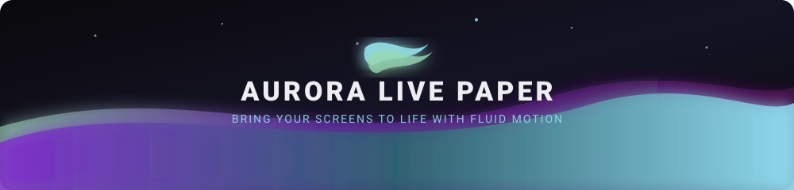
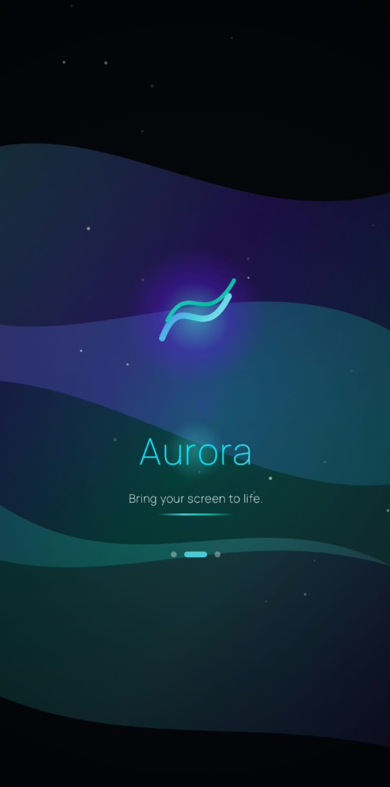
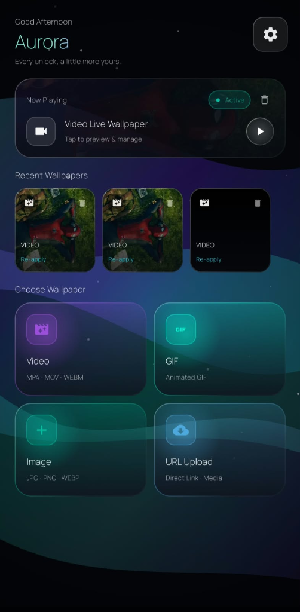

<p align="center">
  
</p>

<p align="center">
  
  
  
  
</p>

<p align="center">
  <a href="https://hub.xerj.org/contributors/itsniranjannn">
    
  </a>
</p>

<p align="center">
  
</p>

<p align="center">
  Aurora Live Paper is an Android live wallpaper application built with Kotlin and Jetpack Compose. It brings your home and lock screens to life with video, GIF, and image wallpapers, supported by configurable playback, media validation, and power-aware lifecycle management.
</p>

---

## 📱 Visual Showcase & Design System

<div align="center">

<table>
  <tr>
    <td align="center" width="50%">
      <b>✨ Welcome & Onboarding Experience</b>
      <br/><br/>
      
      <br/>
      <sub><i>Cosmic gradient introduction with fluid visual styling</i></sub>
    </td>
    <td align="center" width="50%">
      <b>🎛️ Wallpaper Dashboard & Media Hub</b>
      <br/><br/>
      
      <br/>
      <sub><i>Media selection interface and wallpaper management</i></sub>
    </td>
  </tr>
</table>

</div>

---

## ⚡ Key Highlights

<table>
  <tr>
    <td width="50%">
      <h3 align="center">🎬 Universal Media Engine</h3>
      <ul>
        <li><b>Video Playback:</b> Video wallpaper playback runs on Android's hardware-accelerated <code>MediaPlayer</code> inside the wallpaper engine. Media3 ExoPlayer powers the in-app preview.</li>
        <li><b>GIF Support:</b> Animated GIF handling using native decoding capabilities.</li>
        <li><b>Dynamic Scaling:</b> Fit and Fill options for adjusting wallpaper presentation while maintaining the playback configuration.</li>
        <li><b>Media Selection:</b> Import and manage supported image, GIF, and video wallpaper assets.</li>
      </ul>
    </td>
    <td width="50%">
      <h3 align="center">⚡ Intelligent Power Guard</h3>
      <ul>
        <li><b>Lifecycle-Aware Playback:</b> Playback suspension when the wallpaper is no longer actively visible.</li>
        <li><b>Screen State Awareness:</b> Handles screen-off and wallpaper visibility lifecycle events.</li>
        <li><b>Battery Saver Integration:</b> Configurable behavior when Android Battery Saver is enabled.</li>
        <li><b>Low Battery Protection:</b> Configurable battery threshold for reducing unnecessary playback.</li>
      </ul>
    </td>
  </tr>
  <tr>
    <td width="50%">
      <h3 align="center">🔒 Native Lock Screen Support</h3>
      <ul>
        <li><b>Flexible Wallpaper Setup:</b> Configure wallpaper for the Home Screen, Lock Screen, or both where supported by the device.</li>
        <li><b>Audio Isolation:</b> Audio management based on screen and keyguard state.</li>
        <li><b>Modern Android Compatibility:</b> Handles Android wallpaper lifecycle behavior across supported Android versions.</li>
      </ul>
    </td>
    <td width="50%">
      <h3 align="center">🛡️ Resilient Recovery & Safety</h3>
      <ul>
        <li><b>Autonomous Recovery:</b> Exponential backoff strategy to manage repeated playback recovery attempts.</li>
        <li><b>Sliding-Window Limiter:</b> Limits consecutive recovery cycles to help prevent repeated crash or restart loops.</li>
        <li><b>Asynchronous Logger:</b> Background logging pipeline designed to avoid blocking the main UI thread with disk operations.</li>
        <li><b>Media Validation:</b> Pre-flight checks for media dimensions, frame rates, and file sizes.</li>
      </ul>
    </td>
  </tr>
</table>

---

## 🎨 Cosmic Color Palette

Aurora Live Paper's design language draws inspiration from polar auroras dancing across dark night skies.

| Swatch | Color Name | Hex Token | Material Role |
|:---:|:---|:---:|:---|
|  | **Aurora Night** | `#0A090C` | Root Background |
|  | **Surface Indigo** | `#2A2D43` | Cards & Elevated Surfaces |
|  | **Royal Violet** | `#7F2CCB` | Primary Accent & Highlights |
|  | **Stormy Teal** | `#2C666E` | Secondary Surface & Toggles |
|  | **Frosted Blue** | `#90DDF0` | Tertiary & Active Indicators |
|  | **Aurora Glow** | `#97D8B2` | Status Highlights & Badges |

---

## 🏗️ Architecture & Core Components

The application is organized around wallpaper playback, media management, user settings, and lifecycle-aware recovery.

```text
com.niranjan.auroralivepaper/
├── AuroraWallpaperService.kt      # Core wallpaper engine and playback lifecycle
├── MainActivity.kt                 # Compose activity and navigation coordinator
├── data/
│   ├── AuroraDebugLogger.kt        # Asynchronous logging and log management
│   └── SettingsPrefs.kt            # Persistent settings and preferences
├── ui/
│   ├── picker/                     # Media import, gallery and asset selection
│   ├── preview/                    # Wallpaper preview and playback controls
│   ├── settings/                   # Battery, audio, scaling and logging settings
│   └── theme/                      # Colors, typography and application theme
└── util/
    ├── MediaValidator.kt           # Media dimension, FPS and file-size validation
    ├── RecoveryLimiter.kt          # Recovery throttling and backoff management
    └── WebVideoExtractor.kt        # Video extraction and media staging
```

---

## 🚀 Getting Started

Follow these instructions to clone, build, and run Aurora Live Paper locally.

### Prerequisites

- **Android Studio:** Ladybug or newer
- **JDK:** Use the version supported by the project's Gradle and Android Gradle Plugin configuration. Android Studio's bundled JBR is recommended.
- **Android SDK:** Compile SDK 35
- **Minimum Android Version:** Android 8.0 Oreo (API 26+)
- **Git:** Required to clone the repository

### 1. Clone the Repository

```bash
git clone https://github.com/itsniranjannn/Auroralivepaper.git
cd Auroralivepaper
```

### 2. Open the Project

1. Open Android Studio.
2. Select **Open**.
3. Navigate to the cloned `Auroralivepaper` directory.
4. Allow Gradle synchronization to finish.

### 3. Run Unit Tests

On Windows:

```powershell
.\gradlew.bat testDebugUnitTest
```

On Linux or macOS:

```bash
./gradlew testDebugUnitTest
```

### 4. Assemble Debug APK

Windows:

```powershell
.\gradlew.bat assembleDebug
```

Linux/macOS:

```bash
./gradlew assembleDebug
```

The debug APK is generated at:

```text
app/build/outputs/apk/debug/app-debug.apk
```

### 5. Assemble Release APK

Windows:

```powershell
.\gradlew.bat assembleRelease
```

Linux/macOS:

```bash
./gradlew assembleRelease
```

The release APK is generated at:

```text
app/build/outputs/apk/release/app-release.apk
```

For a distributable release, configure signing credentials and verify the release build configuration before publishing.

---

## 🔒 Security & Privacy

Aurora Live Paper focuses on local media handling, controlled playback, and minimizing unnecessary background work.

- **No Analytics:** The project is designed without analytics libraries or third-party tracking integrations.
- **Internal Storage:** Imported media can be staged in the application's internal storage to reduce exposure to external file changes.
- **Media Validation:** Media assets are checked before processing to help avoid problematic dimensions, frame rates, and file sizes.
- **Audio State Management:** Playback audio is managed according to screen and keyguard state.
- **Lifecycle Management:** Playback behavior responds to Android wallpaper and screen lifecycle events.

---

## 🏆 Open Source Recognition

<p align="center">
  <a href="https://hub.xerj.org/contributors/itsniranjannn">
    
  </a>
</p>

Aurora Live Paper was selected for inclusion in the **XERJ Corpus Hub**, a reference collection designed to help AI coding agents retrieve existing code implementations.

The selected contribution includes:

- **Commit:** `435a4ffe88`
- **Implementation:** Agent B — Tasks B1–B6
- **Files:** 6
- **Lines:** 695
- **Language:** Kotlin

The repository is indexed with attribution under its MIT licence.

🔗 **[View XERJ Contributor Profile](https://hub.xerj.org/contributors/itsniranjannn)**

---

## 📄 License

This project is licensed under the **MIT License**.

See the [LICENSE](LICENSE) file for the complete licence text and usage permissions.

---

<div align="center">

### Crafted with 💜 for a smoother, more vibrant Android experience.

**Aurora Live Paper · Kotlin · Jetpack Compose**

[GitHub Repository](https://github.com/itsniranjannn/Auroralivepaper) · [XERJ Contributor Profile](https://hub.xerj.org/contributors/itsniranjannn)

</div>
