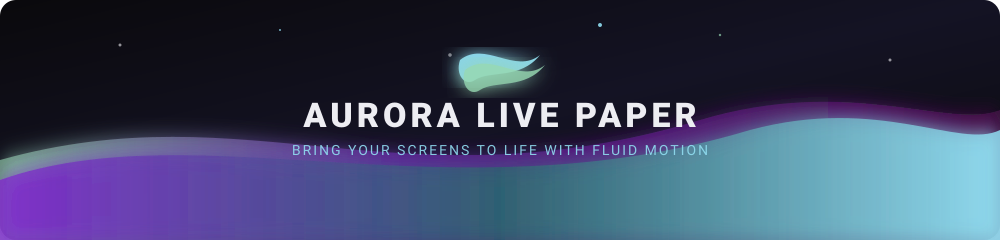
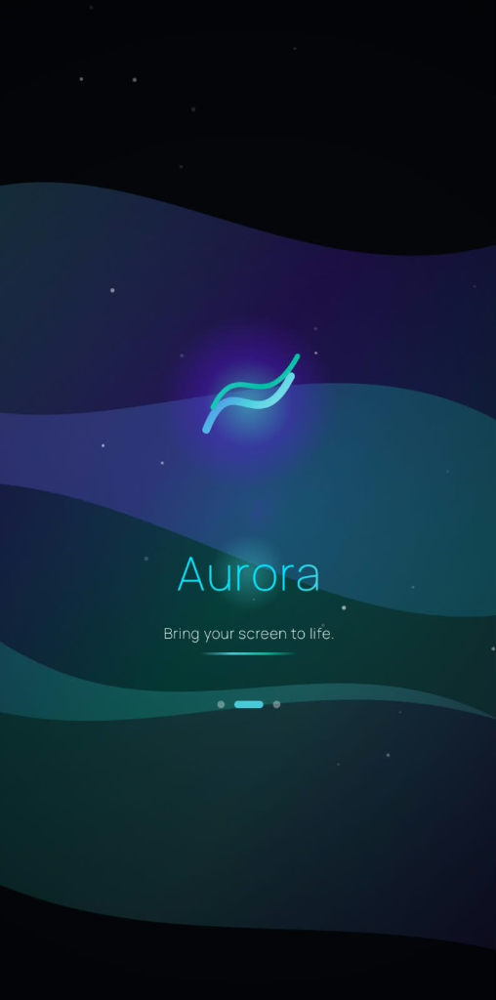
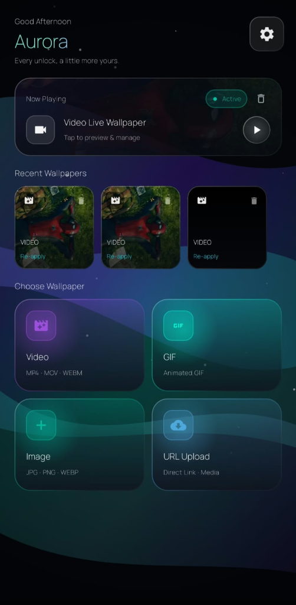


<p align="center">
  
</p>

[-7F2CCB?style=for-the-badge&logo=android&logoColor=white)](https://developer.android.com)
[](https://kotlinlang.org)
[](https://developer.android.com/jetpack/compose)
[](LICENSE)

<br/>

<p align="center">
  
</p>

---

</div>

## 📱 Visual Showcase & Design System

<div align="center">
  <table>
    <tr>
      <td align="center" width="50%">
        <b>✨ Welcome & Onboarding Experience</b>
        <br/><br/>
        
        <br/>
        <sub><i>Cosmic gradient intro with fluid wave motion</i></sub>
      </td>
      <td align="center" width="50%">
        <b>🎛️ Wallpaper Dashboard & Media Hub</b>
        <br/><br/>
        
        <br/>
        <sub><i>Quick video/GIF/image picker with live playback manager</i></sub>
      </td>
    </tr>
  </table>
</div>

---

## ⚡ Key Highlights

<table>
  <tr>
    <td width="50%">
      <h3 align="center">🎬 Universal Media Engine</h3>
      <ul>
        <li><b>High-Definition Video Playback:</b> Ultra-smooth playback powered by Android <code>MediaPlayer</code> & Media3 ExoPlayer.</li>
        <li><b>Zero-Lag GIF Support:</b> Native <code>Movie</code> streaming decoder optimized for dynamic animated loop assets.</li>
        <li><b>Dynamic Scaling (Fit / Fill):</b> Live aspect ratio adjustments without interrupting video playback or rebuilding player instances.</li>
      </ul>
    </td>
    <td width="50%">
      <h3 align="center">⚡ Intelligent Power Guard</h3>
      <ul>
        <li><b>Zero Background Overhead:</b> Hardware-level pause when screen turns off or launcher is obscured.</li>
        <li><b>Battery Saver Synced:</b> Automatic rendering freeze when system Battery Saver is engaged.</li>
        <li><b>Low Battery Protection:</b> Customizable low-battery threshold freeze to prevent battery drain.</li>
      </ul>
    </td>
  </tr>
  <tr>
    <td width="50%">
      <h3 align="center">🔒 Native Lock Screen Support</h3>
      <ul>
        <li><b>Simultaneous Setup:</b> Apply seamlessly to <i>Home Screen</i>, <i>Lock Screen</i>, or <i>Both</i>.</li>
        <li><b>Audio Isolation Guard:</b> Audio automatically mutes while the keyguard is active and only resumes upon secure unlock.</li>
        <li><b>Modern API 34+ Aware:</b> Tailored detection for Android 14+ lock screen wallpaper managers and Samsung One UI.</li>
      </ul>
    </td>
    <td width="50%">
      <h3 align="center">🛡️ Resilient Recovery & Safety</h3>
      <ul>
        <li><b>Autonomous Recovery:</b> Exponential backoff ladder (1s, 2s, 4s, 8s, 30s) prevents crash loops.</li>
        <li><b>Sliding-Window Limiter:</b> Rate-limits consecutive recovery cycles to protect OS stability.</li>
        <li><b>Async Daemon Logger:</b> Non-blocking background log pipeline with zero main thread disk I/O.</li>
      </ul>
    </td>
  </tr>
</table>

---

## 🎨 Cosmic Color Palette

Aurora Live Paper's design language draws inspiration from polar auroras dancing across dark night skies:

| Swatch | Color Name | Hex Token | Material Role |
| :---: | :--- | :---: | :--- |
|  | **Aurora Night** | `#0A090C` | Root Background |
|  | **Surface Indigo** | `#2A2D43` | Cards & Elevated Surfaces |
|  | **Royal Violet** | `#7F2CCB` | Primary Accent & Highlights |
|  | **Stormy Teal** | `#2C666E` | Secondary Surface & Toggles |
|  | **Frosted Blue** | `#90DDF0` | Tertiary & Active Indicators |
|  | **Aurora Glow** | `#97D8B2` | Status Highlights & Badges |

---

## 🏗️ Architecture & Core Components

```
com.niranjan.auroralivepaper/
├── AuroraWallpaperService.kt      # Core WallpaperService engine (lifecycle, scaling, playback)
├── MainActivity.kt                # Jetpack Compose single-activity coordinator & navigation
├── data/
│   ├── AuroraDebugLogger.kt       # Daemon-thread async rotating log system (200 KB cap)
│   └── SettingsPrefs.kt           # SharedPreferences layer for audio, power & scaling prefs
├── ui/
│   ├── picker/                    # WallpaperPickerScreen (media import, gallery, safe staging)
│   ├── preview/                   # PreviewScreen (ExoPlayer video/GIF preview with live aspect toggle)
│   ├── settings/                  # WallpaperSettingsScreen (battery threshold, audio volume, logs)
│   └── theme/                     # Aurora dark design system (Color, Theme, Typography)
└── util/
    ├── MediaValidator.kt          # Pre-flight asset dimension, FPS & size sanity checks
    ├── RecoveryLimiter.kt         # Sliding-window rate limiter with exponential backoff sequence
    └── WebVideoExtractor.kt       # Direct CDN video extraction & staging pipeline
```

---

## 🚀 Getting Started

### Prerequisites
* **Android Studio Ladybug (or newer)**
* **JDK 21 / 25** (Android Studio Bundled JBR recommended)
* **Android SDK**: `compileSdk 35`, `minSdk 26` (Android 8.0 Oreo+)

### Build & Run

1. **Clone the repository:**
   ```bash
   git clone https://github.com/your-username/aurora-live-paper.git
   cd aurora-live-paper
   ```

2. **Run Unit Tests:**
   ```bash
   ./gradlew testDebugUnitTest
   ```

3. **Assemble Debug APK:**
   ```bash
   ./gradlew assembleDebug
   ```

4. **Assemble Signed Release APK:**
   ```bash
   ./gradlew assembleRelease
   ```
   *The optimized, minified APK will be generated at:*  
   `app/build/outputs/apk/release/app-release.apk`

---

## 📄 License

This project is licensed under the **MIT License** — see the [LICENSE](LICENSE) file for full details.

```text
MIT License
Copyright (c) 2026 Niranjan.K

Permission is hereby granted, free of charge, to any person obtaining a copy
of this software and associated documentation files (the "Software"), to deal
in the Software without restriction, including without limitation the rights
to use, copy, modify, merge, publish, distribute, sublicense, and/or sell
copies of the Software, and to permit persons to whom the Software is
furnished to do so...
```

---

## 🔒 Security & Privacy

* **Zero Tracking:** No analytics libraries, third-party trackers, or background telemetry.
* **Storage Isolation:** Media assets are staged securely within internal application storage (`filesDir`), preventing tampering or accidental external deletion.
* **Hardware Mute Protection:** Audio stream is hardware-muted whenever the screen turns off or lock screen wakes up, ensuring no accidental sound leakages occur in public spaces.

---

<div align="center">

---

Crafted with 💜 for a smoother, more vibrant Android experience.

</div>


